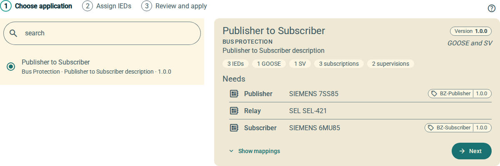

= OpenSCD Plugin: Stencil
:uri-repo: https://github.com/OpenPowerShift/oscd-editor-stencil
:uri-openscd: https://openscd.org
:uri-openwc: https://github.com/open-wc/open-wc
:docs: docs/modules/ROOT/pages

image:{uri-repo}/actions/workflows/test.yml/badge.svg[title='Unit Tests',link={uri-repo}/actions/workflows/test.yml]
image:https://img.shields.io/badge/built%20with-open--wc-blue.svg[link={uri-openwc},title='Built with open-wc recommendations']

A stencil is a reusable, tested piece of IEC 61850 communication configuration, for example a bus zone relay and its merging units.
It records which GOOSE and sampled value (SV) control blocks one IED sends to another, which signals are subscribed, and the supervisions.

This {uri-openscd}[OpenSCD] editor plugin applies a stencil to the IEDs of the open document in one undoable change.
It also captures new stencil applications from configured IEDs, and manages a library of stencils.

* It uses `@openscd/oscd-api` (EditV2), `@openscd/scl-lib` and `@omicronenergy/oscd-ui`.
* The interface is available in English, German and Portuguese.
* It uses the link:LICENSE[Apache License].

== Documentation

The user documentation is an Antora component in `docs/`, published on the OpenSCD documentation site.
To read it in the repository, start at link:{docs}/introduction.adoc[Introduction]:

* link:{docs}/first-steps.adoc[First steps]
* link:{docs}/apply.adoc[Apply a stencil]
* link:{docs}/mappings.adoc[Read the table of control blocks]
* link:{docs}/stencil-tags.adoc[Stencil tags]
* link:{docs}/manage.adoc[Manage stencils]
* link:{docs}/create-application.adoc[Create an application from a document]
* link:{docs}/edit-json.adoc[Edit a stencil as JSON]
* link:{docs}/installation.adoc[Get the plugin]
* link:{docs}/development.adoc[Development]: build, tests, screenshots, theming, translations and release

== Quick start for developers

[source,sh]
----
npm ci
npm start          # demo at http://localhost:8004/demo/
npm test           # unit tests with coverage
----

For everything else, refer to link:{docs}/development.adoc[Development].

© OpenSCD Daniel Mulholland, Christian Dinkel
